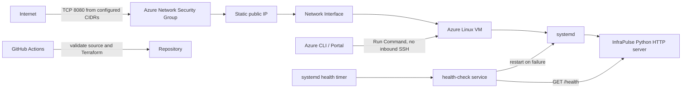

# InfraPulse Azure architecture

Terraform creates a resource group, VNet and subnet, an NSG, a Standard public
IP, network interface, and one Ubuntu Server 22.04 LTS Gen2 VM. Central India (`centralindia`)
is the selected deployment region. The VM is reachable
over HTTP only from `http_source_cidrs`; the NSG does not open TCP 22. Outbound
internet traffic is limited to HTTP and HTTPS for package installation and VM
agent operations.

Cloud-init installs Python and curl, writes the application and systemd units,
then enables `infrapulse.service` and its health timer. systemd restarts process
crashes, while the separate timer checks `/health` and requests a service
restart if the check fails.

Use Azure Run Command from the portal or CLI for administrative scripts. The
Azure VM agent runs those scripts through the Azure control plane, so an
interactive SSH port or Bastion deployment is not required. GitHub Actions
validates the project but does not authenticate to Azure or deploy resources.

## SRE assumptions and limitations

This demo uses the four SRE golden signals—latency, traffic, errors, and
saturation—as an operations checklist. It does not provide a complete
observability stack or production SLOs.

- **Latency:** The app logs request method, route, and status, but not request
  duration. There are no latency distributions, percentiles, or latency alerts.
- **Traffic:** Each request is logged, which is useful for individual
  investigations. Logs are not aggregated into request rates, traffic
  dashboards, or capacity trends.
- **Errors:** Unknown routes return HTTP 404. The health checker logs failed
  local probes and requests a restart. Logs stay on the VM; there is no
  centralized error-rate dashboard, alert routing, or notification.
- **Saturation:** Operators can inspect CPU/load, memory, and disk with the
  commands in the runbook. No thresholds or saturation alerts are configured.
- **Availability:** The systemd timer probes `localhost` about once a minute.
  It checks that the app responds locally, not that a user can reach the public
  endpoint. It does not verify recovery after requesting a restart. There is
  no defined SLI/SLO, error budget, synthetic external probe, or VM redundancy.
- **Scope:** The service runs on one VM and has no autoscaling, failover, or
  application-level dependency checks. `/health` reports process responsiveness
  only; it does not test external services.

The runbook provides manual investigation steps. Azure Monitor metrics may be
viewed in the portal, but this Terraform configuration does not create alert
rules or centralized log collection.
