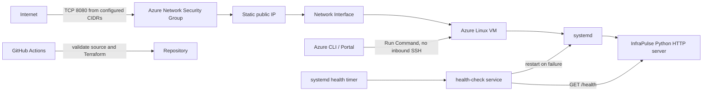

# InfraPulse Azure architecture

Terraform creates a resource group, VNet and subnet, an NSG, a Standard public
IP, network interface, and one Ubuntu Server 22.04 LTS Gen2 VM. Central India (`centralindia`)
is the selected deployment region. The VM is reachable
over HTTP only from `http_source_cidrs`; the NSG does not open TCP 22. Outbound
internet traffic is limited to HTTP and HTTPS for package installation and VM
agent operations.

Cloud-init installs Python and curl, writes the application and systemd units,
then enables `infrapulse.service` and its health timer. systemd restarts process
crashes, while the separate timer checks `/health` and requests a service
restart if the check fails.

Use Azure Run Command from the portal or CLI for administrative scripts. The
Azure VM agent runs those scripts through the Azure control plane, so an
interactive SSH port or Bastion deployment is not required. GitHub Actions
validates the project but does not authenticate to Azure or deploy resources.
